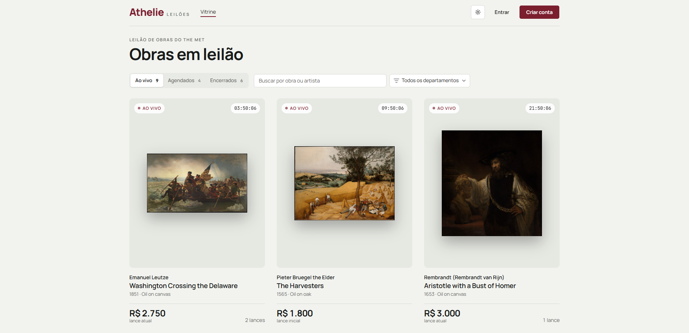

<div align="center">
  <picture>
    <source media="(prefers-color-scheme: dark)" srcset="docs/img/logo-dark.svg">
    
  </picture>
</div>

<details>
  <summary>Sumário</summary>

1. [Sobre o projeto](#sobre-o-projeto)
   - [Funcionalidades](#funcionalidades)
   - [Feito com](#feito-com)
2. [Como rodar](#como-rodar)
   - [Pré-requisitos](#pré-requisitos)
   - [1. Clonar o repositório](#1-clonar-o-repositório)
   - [2. Criar o arquivo de variáveis](#2-criar-o-arquivo-de-variáveis)
   - [3. Subir os containers](#3-subir-os-containers)
   - [4. Acessar](#4-acessar)
   - [Parar e resetar](#parar-e-resetar)
   - [Testes automatizados](#testes-automatizados)
   - [Sem Docker](#sem-docker)
3. [Roteiro de demonstração](#roteiro-de-demonstração)
4. [Comportamentos inesperados](#comportamentos-inesperados)
5. [Uso de IA](#uso-de-ia)

</details>

## Sobre o projeto

Casa de leilões online com obras do acervo do Metropolitan Museum. O leiloeiro cria os lotes, os licitantes dão lances ao vivo, o vencedor recebe um comprovante, e qualquer pessoa audita o histórico de lances, sem login, com detecção de adulteração.



<table>
  <tr><td>Aplicação</td><td><a href="https://athelie-leiloes.vercel.app">https://athelie-leiloes.vercel.app</a></td></tr>
  <tr><td>API</td><td><a href="https://athelie-leiloes-api.vercel.app">https://athelie-leiloes-api.vercel.app</a> (saúde em <code>/health</code>)</td></tr>
  <tr><td>Repositório</td><td><a href="https://github.com/DevPauloV/desafio-leilao">https://github.com/DevPauloV/desafio-leilao</a></td></tr>
</table>

## Funcionalidades

- **Vitrine** com lotes ao vivo, agendados e encerrados, com busca e filtro.
- **Sala ao vivo** com lances em tempo real, contagem regressiva e anti-sniping.
- **Carteira** com saldo comprometido enquanto o licitante lidera.
- **Painel do leiloeiro** para criar lotes a partir do Met e cancelar com estorno.
- **Comprovante** e **auditoria pública**, sem dados pessoais.

Opcionais feitos: busca e filtro, cancelamento com estorno, Docker Compose, testes automatizados e dark mode.

## Feito com

**Front-end:** [ler sobre o front-end e seu funcionamento](docs/frontend.md)


**Back-end:** [ler sobre a arquitetura, as regras e os testes](docs/backend.md)


**Infra:** Docker Compose para rodar local; deploy do front e da API na Vercel e do banco no MongoDB Atlas. A API iria para o Railway, que suspendeu os cadastros novos; o código continua pronto para ele ([por quê](docs/adr/0005-deploy.md)).


**Mais documentação:**
- [Rotas da API](docs/contract.md): rotas REST, eventos Socket.IO e códigos de erro.
- [Testes automatizados](docs/testes.md): como rodar e o que cada teste cobre, incluindo concorrência.
- [Auditoria e privacidade](docs/auditoria.md): como a cadeia de hashes HMAC detecta adulteração.
- [Decisões (ADRs)](docs/adr/): por que cada escolha importante foi feita.

## Como rodar

Se quiser só usar o sistema, acesse a [aplicação no ar](https://athelie-leiloes.vercel.app). Para rodar na sua máquina, o Docker sobe front, API e banco com um comando.

### Pré-requisitos

- [Git](https://git-scm.com/downloads)
- [Docker Desktop](https://www.docker.com/products/docker-desktop/) (ou Docker Engine com Compose v2), aberto e rodando
- [Node.js](https://nodejs.org/) 20.19+, só para os testes ou para rodar sem Docker

### 1. Clonar o repositório

```bash
git clone https://github.com/DevPauloV/desafio-leilao.git
cd desafio-leilao
```

### 2. Criar o arquivo de variáveis

```bash
cp .env.example .env
```

No PowerShell, use `Copy-Item .env.example .env`. Os valores padrão já funcionam localmente; cada variável está explicada no próprio [`.env.example`](.env.example).

### 3. Subir os containers

```bash
docker compose up --build
```

A primeira vez demora mais, porque baixa as imagens e instala as dependências. O Compose sobe o MongoDB, depois a API (que cria o seed com usuários e lotes) e por último o front.

### 4. Acessar

| Serviço | Endereço |
|---|---|
| Aplicação | http://localhost:8080 |
| API | http://localhost:3000 (saúde em http://localhost:3000/health) |

Os usuários para entrar estão no [roteiro de demonstração](#roteiro-de-demonstração).

### Parar e resetar

```bash
docker compose down      # para os containers e mantém os dados
docker compose down -v   # para e apaga o banco; o seed recria tudo na próxima subida
```

Se a porta 3000 ou 8080 já estiver em uso, troque `API_PORT` ou `FRONT_PORT` no `.env`. Ao mudar a porta da API, ajuste também o `VITE_API_URL`; ao mudar a do front, o `CORS_ORIGIN`.

### Testes automatizados

São 125 testes, com o MongoDB em memória, então não precisam de Docker:

```bash
cd athelie-leiloes-api
npm ci
npm test
```

Como funcionam e o que cobrem: [docs/testes.md](docs/testes.md).

### Sem Docker

Precisa de Node.js e de um MongoDB em replica set (local ou Atlas gratuito). O passo a passo está no [back-end](docs/backend.md#rodar-sem-docker).

## Roteiro de demonstração

Senha de todos: **`athelie12345`**

| Papel | E-mail |
|---|---|
| Leiloeiro | `leiloeiro@athelie.dev` |
| Licitante | `licitante01@athelie.dev` |
| Licitante | `licitante02@athelie.dev` |

Na tela **Entrar**, o painel *Acesso de avaliação* preenche qualquer uma dessas contas com um toque.

O seed cria 20 lotes, cada um com uma obra diferente: ao vivo, agendados, encerrados e um cancelado.

1. Abra o mesmo lote ao vivo (ex.: *Sunflowers*) com os dois licitantes, em janelas diferentes, e dispute.
2. Tente um lance abaixo do mínimo, sem saldo ou cobrindo o próprio lance.
3. Abra a **Auditoria** do lote.
4. Como leiloeiro, crie um lote no painel e acompanhe até o comprovante.
5. Para ver a auditoria acusar adulteração, rode o script de demonstração ([passo a passo](docs/auditoria.md#ver-funcionando)).

[Roteiro completo, com o que esperar em cada passo](docs/roteiro.md)

## Comportamentos inesperados

- O Met aposentou o `/v1/search` em 01/10/2026; a busca usa o `/v1.1/search`. Obras sem imagem ou fora do domínio público são puladas, então a busca pode trazer menos de 20.
- O Met cataloga cada impressão de uma gravura (ex.: Hokusai) com um id próprio. A busca mostra uma vez só cada obra com mesmo título, artista e data.
- O resultado do lote aparece até ~2 s depois do fim ("Apurando resultado…").
- O seed não repõe saldo: depois de muitas reinicializações, deposite pela carteira ou resete o banco.
- No ar, a API roda como função da Vercel ([ADR 0005](docs/adr/0005-deploy.md)):
  - a conexão em tempo real cai a cada ~5 min e volta sozinha em ~1 s;
  - um lote que acaba sem ninguém conectado é liquidado na primeira requisição seguinte;
  - o primeiro acesso depois de um tempo parado é mais lento;
  - o rate limit fica em memória, por instância;
  - o socket desconecta quando a aba fica oculta e reconecta quando ela volta.
- No Windows, o npm 10.8.2 pode quebrar no `npm install`; use `npx npm@11 install`.

## Uso de IA

Usei o Claude Code para agilizar código, testes e documentação; as decisões e a revisão foram minhas. Detalhes em [docs/ai-usage.md](docs/ai-usage.md).
