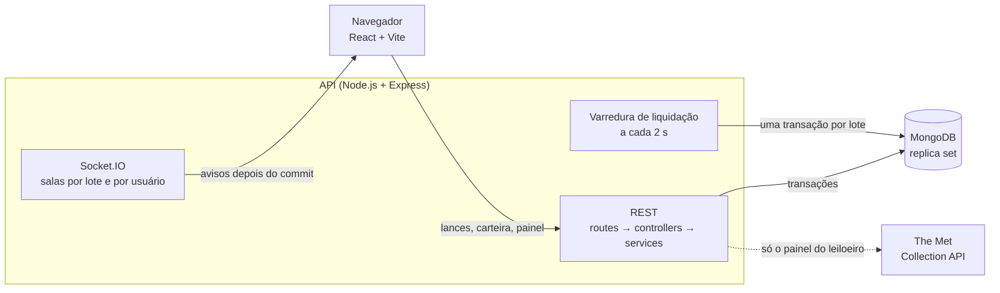
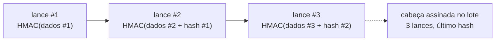

# Athelie Leilões

Casa de leilões online. O leiloeiro cria lotes a partir de obras do acervo do Metropolitan Museum (The Met Collection API), os licitantes dão lances ao vivo, o vencedor recebe um comprovante público, e qualquer pessoa audita o histórico de lances de um lote, sem login, com detecção de adulteração.


| | |
|---|---|
| Aplicação | **https://SEU-FRONT.vercel.app** |
| API | https://SUA-API.up.railway.app (saúde em `/health`) |
| Repositório | https://github.com/DevPauloV/desafio-leilao |

## Testar em 2 minutos

Senha de todos: **`athelie12345`**

| Papel | E-mail |
|---|---|
| Leiloeiro | `leiloeiro@athelie.dev` |
| Licitante | `licitante01@athelie.dev` (R$ 50.000 na carteira) |
| Licitante | `licitante02@athelie.dev` (R$ 50.000 na carteira) |

1. Entre como `licitante01` numa janela e como `licitante02` numa janela anônima, abra o lote **ao vivo** e dê lances alternados. Os dois veem o lance na hora, e quem é superado recebe um aviso.
2. Force as recusas: abaixo do mínimo, cobrir o próprio lance, sem saldo, lote agendado ou encerrado.
3. Abra **Auditoria** na sala: o selo mostra "íntegro" e a cadeia de hashes.
4. Como leiloeiro, busque "monet" no painel, crie um lote curto e acompanhe a liquidação e o comprovante.

O seed também cria um lote agendado, um encerrado com comprovante e um cancelado com estorno. Se não houver lote ao vivo quando a API sobe, ele cria outro, então sempre há um leilão aberto para testar.

## O que tem

| Tela | O que faz |
|---|---|
| Vitrine `/` | Lotes ao vivo, agendados e encerrados (cancelados ficam ocultos), com busca e filtro |
| Sala `/lotes/:id` | Lance atual, contagem regressiva, histórico e lance em tempo real |
| Painel `/painel` | Leiloeiro busca obras no Met, cria lotes, cancela com estorno e vê resultados |
| Carteira `/carteira` | Saldo total, comprometido e disponível; depósito |
| Meus arremates `/arremates` | Ganhando, superado, arrematado ou perdido, com link do comprovante |
| Comprovante `/r/:code` | Público, sem dados pessoais |
| Auditoria `/auditoria/:id` | Pública, sem login: verifica a integridade dos lances |

**Opcionais, todos feitos:** busca e filtro de lotes, cancelamento com estorno, Docker Compose, testes automatizados e dark mode.

## Como rodar

**Com Docker** (só precisa do Docker):

```bash
cp .env.example .env
docker compose up --build
```

Front em http://localhost:8080 e API em http://localhost:3000. O seed roda sozinho e não duplica nada se subir de novo.

| Para | Comando |
|---|---|
| Parar (mantém os dados) | `docker compose down` |
| Resetar o banco | `docker compose down -v && docker compose up --build` |
| Rodar os testes | `cd athelie-leiloes-api && npm test` (Mongo em memória, sem Docker) |

**Sem Docker:** Node 20.19+ e um MongoDB **em replica set** (por exemplo, `mongod --replSet rs0` e `mongosh --eval "rs.initiate()"` uma vez, ou um Atlas gratuito). Depois, `npm ci && npm run dev` em `athelie-leiloes-api` e em `athelie-leiloes-front` (front em http://localhost:5173).

As variáveis estão explicadas no próprio [`.env.example`](.env.example). A API valida todas com Zod e não sobe se alguma estiver errada. Fora da sua máquina, troque `JWT_SECRET` e `AUDIT_SECRET` (`openssl rand -hex 32`).

## Arquitetura



- **Stack:** React + Vite + shadcn/ui + Tailwind no front; Express 5 + Mongoose + Socket.IO na API; Zod em toda entrada; Vitest nos testes.
- **Back-end em camadas simples** (routes → controllers → services → models). As regras de lance e a cadeia de hashes são funções puras em `domain/`, testadas isoladamente.
- **O lance entra pela REST, não pelo socket.** O Socket.IO só avisa depois que a transação foi confirmada, então ninguém vê um lance que depois foi desfeito.
- **Só o painel depende do Met.** Ao criar o lote, a obra e a imagem são copiadas para o banco. Vitrine, sala, auditoria e comprovante funcionam com o Met fora do ar (há teste para isso).

Contrato completo (rotas, eventos e erros) em [`docs/contract.md`](docs/contract.md). Cada decisão importante tem um ADR curto:

| ADR | Decisão |
|---|---|
| [0001](docs/adr/0001-estrutura-do-back-end.md) | Back-end em camadas, sem repositórios nem abstrações extras |
| [0002](docs/adr/0002-mongodb-transacoes.md) | MongoDB em replica set, com transações para lance, saldo e liquidação |
| [0003](docs/adr/0003-interpretacoes-do-pdf.md) | Interpretações do enunciado (lance mínimo, anti-sniping, cancelamento) |
| [0004](docs/adr/0004-independencia-do-met.md) | Obra e imagem copiadas para o banco |
| [0005](docs/adr/0005-deploy.md) | Deploy em Vercel + Railway + Atlas |
| [0006](docs/adr/0006-lance-via-rest.md) | Lance pela REST; o Socket.IO só avisa |
| [0007](docs/adr/0007-liquidacao-por-varredura.md) | Liquidação por varredura, uma transação por lote |
| [0008](docs/adr/0008-cadeia-de-hashes-hmac.md) | Cadeia de hashes HMAC contra adulteração |
| [0009](docs/adr/0009-pseudonimo-por-lote.md) | Pseudônimo por lote nas telas públicas |

## Regras de negócio

- **Lance mínimo:** o primeiro ≥ lance inicial; os seguintes ≥ lance atual + incremento. O líder não cobre o próprio lance, e o leiloeiro não dá lances.
- **Saldo:** disponível = total − comprometido. O valor de quem lidera fica comprometido e é liberado na hora em que essa pessoa é superada.
- **Anti-sniping:** lance nos últimos 2 minutos muda o fim para **horário do lance + 2 min**. Somar ao fim atual deixaria lances seguidos empurrarem o fim cada vez mais longe.
- **Liquidação:** numa única transação, debita o vencedor, credita o leiloeiro e gera o comprovante. Lote sem lances termina sem vencedor.
- **Cancelamento:** lote agendado ou ao vivo; o valor comprometido do líder volta na mesma transação.
- **Concorrência:** cada lance é uma transação com update condicional pelo número de lances do lote, então dois lances simultâneos nunca valem sobre o mesmo estado. Os testes disparam 10 ao mesmo tempo. Dinheiro sempre em centavos inteiros.

## Histórico à prova de adulteração

Cada lance guarda o hash do anterior, formando uma cadeia. O hash é um **HMAC-SHA256** com um segredo (`AUDIT_SECRET`) que só a API conhece. O lote guarda a **cabeça** da cadeia (quantidade de lances e último hash), também assinada.



A auditoria recalcula tudo a cada consulta e aponta o primeiro lance com problema:

| Adulteração direto no banco | Como é detectada |
|---|---|
| Alterar valor, horário ou licitante | o hash recalculado não confere |
| Remover um lance do meio | a sequência e o hash anterior do próximo quebram |
| Remover o último ou inserir um lance | a contagem diverge da cabeça assinada |
| Trocar líder, lance atual ou vencedor do lote | diverge do último lance da cadeia |

**Por que HMAC e não SHA-256 puro:** com SHA-256, quem tem acesso ao banco recalcula a cadeia inteira depois de adulterar. Com HMAC, isso exige o segredo.

**Para ver funcionando:** `docker compose exec api npm run demo:tamper -- <lotId> alter` (ou `remove`, `remove --last`, `insert`) e recarregue `/auditoria/<lotId>`.

**Limites:** quem tem o banco **e** o segredo consegue forjar a cadeia. Também é possível voltar a cabeça para uma versão antiga (tirada do oplog ou de um backup); num lote liquidado, o comprovante guarda o hash final e denuncia isso. Detalhes no [ADR 0008](docs/adr/0008-cadeia-de-hashes-hmac.md).

## Privacidade e segurança

- Telas públicas mostram só um **pseudônimo por lote** (`Licitante #A1B2C3`), derivado por HMAC. A mesma pessoa tem códigos diferentes em cada lote, então não dá para segui-la entre leilões. Nenhuma rota pública devolve id, nome ou e-mail.
- JWT com autorização por papel e por dono em cada rota, senhas com bcrypt, Zod em toda entrada (HTTP e socket), `helmet`, CORS restrito e rate limit no login e nos lances.

## Deploy

Front na **Vercel**, API no **Railway** (com o mesmo `Dockerfile` do Compose) e banco no **MongoDB Atlas** (replica set gerenciado). A API não foi para Vercel Functions porque funções serverless não mantêm o WebSocket aberto nem a varredura de liquidação rodando. Configuração completa no [ADR 0005](docs/adr/0005-deploy.md).

## Comportamentos inesperados

- **O Met aposentou o `/v1/search`** em 01/10/2026; a busca usa `/v1.1/search`. Obras sem imagem, fora do domínio público ou com erro são puladas, então uma busca pode trazer menos de 20 resultados.
- **O resultado leva até ~2 s** depois do fim, por causa da varredura. Nesse intervalo, a sala mostra "Apurando resultado…".
- **O seed não repõe saldo.** Cada lote ao vivo recriado compromete mais saldo dos licitantes; deposite pela carteira ou resete o banco.
- **Uma instância da API.** Rate limit e salas do socket ficam em memória; escalar exigiria Redis. A liquidação já é segura com várias instâncias.
- **Reconexão:** o front volta à sala e recarrega o estado; um aviso emitido durante a queda não é reenviado, mas o estado já vem atualizado.
- **A contagem usa a hora do servidor**, então um relógio errado no navegador não muda o fim na tela.
- **npm 10.8.2 no Windows** pode quebrar no `npm install`; use `npx npm@11 install`. O Docker não é afetado.

## Uso de IA

Usei IA (Claude Code) como ferramenta para agilizar a escrita de código, testes e documentação. A arquitetura, a modelagem, as regras e as técnicas (transações, cadeia HMAC, pseudônimos) foram decididas por mim, e todo código passou pela minha revisão e pelos testes antes de entrar. O deploy (Atlas, Railway e Vercel) eu fiz manualmente. Os detalhes estão em [`docs/ai-usage.md`](docs/ai-usage.md).
