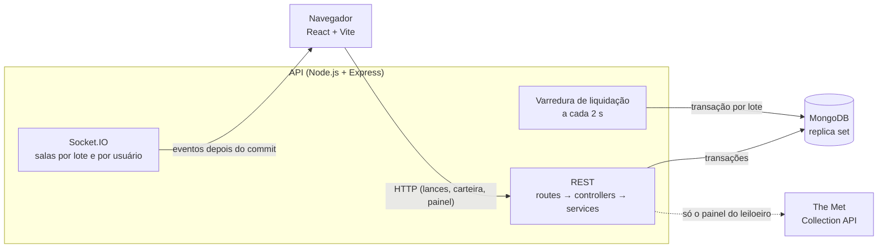
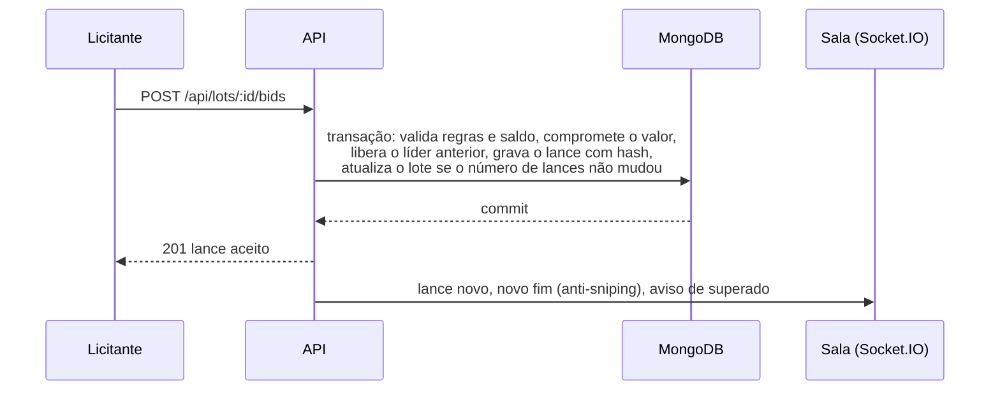
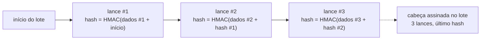

# Athelie Leilões

Casa de leilões online. O leiloeiro cria lotes a partir de obras do acervo do Metropolitan Museum (The Met Collection API), os licitantes dão lances ao vivo, o vencedor recebe um comprovante público, e qualquer pessoa audita o histórico de lances de um lote, sem login, com detecção de adulteração.

Teste técnico Verzel (Elite Dev).


## Links

| | |
|---|---|
| Aplicação (front) | **https://SEU-FRONT.vercel.app** |
| API | https://SUA-API.up.railway.app (saúde em `/health`) |
| Repositório | https://github.com/DevPauloV/desafio-leilao |

Para rodar na sua máquina, basta um comando: `cp .env.example .env && docker compose up --build` ([detalhes](#como-rodar-localmente)).

## Sumário

1. [Usuários de demonstração](#usuários-de-demonstração)
2. [Roteiro rápido de avaliação](#roteiro-rápido-de-avaliação)
3. [Funcionalidades](#funcionalidades)
4. [Telas](#telas)
5. [Como rodar localmente](#como-rodar-localmente)
6. [Variáveis de ambiente](#variáveis-de-ambiente)
7. [Stack](#stack)
8. [Arquitetura](#arquitetura)
9. [Regras de negócio e interpretações](#regras-de-negócio-e-interpretações)
10. [Histórico à prova de adulteração](#histórico-à-prova-de-adulteração)
11. [Privacidade](#privacidade)
12. [Independência da API do Met](#independência-da-api-do-met)
13. [Segurança](#segurança)
14. [Testes](#testes)
15. [Deploy](#deploy)
16. [Comportamentos inesperados e limitações conhecidas](#comportamentos-inesperados-e-limitações-conhecidas)
17. [Uso de IA](#uso-de-ia)

## Usuários de demonstração

Todos com a senha **`athelie12345`**. O seed cria tudo isso ao subir a API.

| Papel | E-mail | O que dá para fazer |
|---|---|---|
| Leiloeiro | `leiloeiro@athelie.dev` | Painel: buscar obras no Met, criar lotes, cancelar com estorno, ver resultados |
| Licitante | `licitante01@athelie.dev` | Dar lances, carteira (R$ 50.000 iniciais), meus arremates |
| Licitante | `licitante02@athelie.dev` | Idem. Abra numa janela anônima para disputar com o licitante 01 em tempo real |

Também dá para criar uma conta nova em `/criar-conta`, escolhendo o papel.

Os lotes do seed:
- um **ao vivo** com lances dos dois;
- um **agendado**;
- um **encerrado** com vencedor e comprovante;
- um **cancelado** com estorno, que só aparece no painel do leiloeiro.

Se não houver lote ao vivo nem agendado quando a API sobe, o seed cria outros. Assim, quem avaliar dias depois ainda encontra um leilão aberto.

## Roteiro rápido de avaliação

1. Abra a vitrine e entre na sala do lote ao vivo.
2. Entre como `licitante01@athelie.dev` numa janela e como `licitante02@athelie.dev` numa janela anônima. Dê lances alternados: os dois veem o lance na hora, e quem foi superado recebe um aviso.
3. Teste as recusas:
   - lance abaixo do mínimo;
   - lance de quem já está ganhando;
   - lance maior que o saldo disponível;
   - lance em lote agendado ou encerrado.
4. Na sala, abra **Auditoria** (`/auditoria/:id`): o selo mostra "íntegro" e a cadeia de hashes de cada lance.
5. Como leiloeiro, busque uma obra no painel ("monet", "vase"), crie um lote que termine em poucos minutos e acompanhe a liquidação e o comprovante.
6. Para ver a auditoria acusar adulteração, rode o script de [demonstração](#histórico-à-prova-de-adulteração) e recarregue a página da auditoria.

## Funcionalidades

### Obrigatórias

| Requisito | Onde ver |
|---|---|
| Leiloeiro cria lotes a partir de itens de uma API pública externa | `/painel`: busca no Met e "Criar lote" |
| Lances ao vivo, vistos por todos na hora | `/lotes/:id` (Socket.IO) |
| Primeiro lance ≥ inicial; seguintes ≥ atual + incremento; líder não cobre o próprio lance | [Regras](#regras-de-negócio-e-interpretações) |
| Saldo disponível = total − comprometido, liberado na hora ao ser superado | `/carteira` |
| Anti-sniping de 2 minutos | contagem da sala estende ao vivo |
| Liquidação: debita o vencedor, credita o leiloeiro, gera comprovante | `/arremates` e `/r/:code` |
| Histórico à prova de adulteração, inclusive direto no banco | `/auditoria/:id` e `npm run demo:tamper` |
| Auditoria e comprovante sem dados pessoais | pseudônimo por lote ([Privacidade](#privacidade)) |
| Vitrine, salas, auditoria e comprovante funcionam com a API externa fora | [Independência do Met](#independência-da-api-do-met) |
| Mensagens de recusa claras | sala do lote, ao dar lance |
| Vitrine com ao vivo, agendados e encerrados; cancelados ocultos | `/` |
| Seed com 1 leiloeiro, 2 clientes e lote ao vivo com lances | [Usuários de demonstração](#usuários-de-demonstração) |
| Deploy público | [Links](#links) |

### Opcionais (todos feitos)

| Opcional | Como ficou |
|---|---|
| Busca e filtro de lotes | busca por título ou artista e filtro por departamento na vitrine |
| Cancelamento com estorno | leiloeiro cancela lote agendado ou ao vivo; o valor comprometido do líder volta na mesma transação |
| Docker Compose | api, front e mongo com um comando |
| Testes automatizados | 123 testes na API, incluindo concorrência ([Testes](#testes)) |
| Dark mode | tema claro e escuro, com alternância no cabeçalho |

## Telas

| Rota | Quem acessa | O que faz |
|---|---|---|
| `/` | todos | Vitrine: lotes ao vivo, agendados e encerrados, com busca e filtro |
| `/lotes/:id` | todos (lance só para licitante) | Sala ao vivo: lance atual, contagem regressiva, histórico e formulário de lance |
| `/auditoria/:id` | todos, sem login | Selo de integridade e cadeia de hashes do lote |
| `/r/:code` | todos, sem login | Comprovante do arremate |
| `/painel` | leiloeiro | Busca no Met, criação de lotes, cancelamento e resultados dos próprios lotes |
| `/carteira` | licitante | Saldo total, comprometido e disponível; depósito |
| `/arremates` | licitante | Lotes em que deu lance: ganhando, superado, arrematado ou perdido, com link do comprovante |
| `/entrar`, `/criar-conta` | todos | Login e cadastro |

## Como rodar localmente

### Com Docker (recomendado)

Pré-requisito: Docker com Docker Compose.

```bash
cp .env.example .env
docker compose up --build
```

| Serviço | URL |
|---|---|
| Front | http://localhost:8080 |
| API | http://localhost:3000 (saúde: `/health`) |
| MongoDB | dentro da rede do Compose (replica set `rs0`) |

- O Compose sobe três containers na ordem: Mongo saudável, depois a API saudável, depois o front.
- O Mongo roda como replica set de 1 nó, porque as transações exigem isso.
- Com `SEED_ON_START=true` (o padrão do `.env.example`), a API cria os usuários e os lotes acima. O seed é idempotente: subir de novo não duplica nada.
- Parar: `docker compose down` (os dados ficam no volume `mongo_data`).
- **Resetar o banco:** `docker compose down -v && docker compose up --build` (apaga o volume e o seed roda do zero).
- Rodar o seed de novo à mão: `docker compose exec api npm run seed`.

Antes de usar em qualquer lugar além da sua máquina, troque `JWT_SECRET` e `AUDIT_SECRET` no `.env` (`openssl rand -hex 32`).

### Sem Docker

Pré-requisitos: Node.js 20.19 ou mais novo e um MongoDB **em replica set** (as transações exigem isso). Por exemplo: `mongod --replSet rs0` e, uma única vez, `mongosh --eval "rs.initiate()"`. Também serve um cluster gratuito do MongoDB Atlas.

```bash
cp .env.example .env          # ajuste MONGO_URI se precisar

cd athelie-leiloes-api
npm ci
npm run dev                    # http://localhost:3000 (lê ../.env)

cd ../athelie-leiloes-front
npm ci
npm run dev                    # http://localhost:5173 (usa a API em http://localhost:3000)
```

## Variáveis de ambiente

Todas ficam no `.env` da raiz, criado a partir do `.env.example`. A API valida tudo com Zod ao subir e não inicia se alguma estiver inválida.

| Variável | Para que serve | Padrão do exemplo |
|---|---|---|
| `MONGO_URI` | conexão com o MongoDB (precisa ser replica set). No Compose, o próprio compose define | `mongodb://localhost:27017/athelie-leiloes?replicaSet=rs0` |
| `JWT_SECRET` | assinatura dos tokens de login | troque antes de publicar |
| `JWT_EXPIRES_IN` | validade do token | `1d` |
| `AUDIT_SECRET` | chave do HMAC da cadeia de lances e dos pseudônimos | troque antes de publicar; não mude depois que houver lances |
| `CORS_ORIGIN` | origens permitidas, separadas por vírgula | `http://localhost:8080,http://localhost:5173` |
| `TRUST_PROXY` | número de proxies na frente da API (o rate limit usa o IP real) | `0` local, `1` no Railway |
| `SEED_ON_START` | cria os dados de demonstração ao subir | `true` |
| `MET_API_BASE` | base da The Met Collection API (sem chave) | `https://collectionapi.metmuseum.org/public/collection/v1` |
| `VITE_API_URL` | URL da API como o navegador a enxerga (entra no build do front) | `http://localhost:3000` |
| `API_PORT`, `FRONT_PORT` | portas expostas pelo Compose | `3000`, `8080` |

## Stack

| Camada | Escolha |
|---|---|
| Front | React + Vite + TypeScript, shadcn/ui + Tailwind (tema claro e escuro) |
| API | Node.js + Express 5 + TypeScript, em camadas: routes → controllers → services → models |
| Banco | MongoDB + Mongoose, replica set para transações |
| Tempo real | Socket.IO no mesmo servidor HTTP do Express |
| Validação | Zod em corpo, query, params, variáveis de ambiente e respostas do Met |
| Testes | Vitest + Supertest + mongodb-memory-server, cobrindo concorrência de lances e de liquidação |
| Infra | Docker Compose (api, front, mongo) e deploy em Vercel + Railway + Atlas |

## Arquitetura



**Caminho de um lance.** O lance entra pela API REST, não pelo socket ([ADR 0006](docs/adr/0006-lance-via-rest.md)). O Socket.IO só avisa os outros depois que a transação foi confirmada, então ninguém vê um lance que depois foi desfeito.



```
athelie-leiloes-api/src/
  config/env.ts        variáveis de ambiente validadas com Zod (a API não sobe com variável inválida)
  constants.ts         papéis, estados, códigos de erro, eventos e números das regras (nada de string solta)
  routes/              rotas e middlewares por recurso (auth, papel, validação, rate limit)
  controllers/         traduzem HTTP para chamadas de serviço
  services/            regras de negócio: lances, carteira, lotes, liquidação, auditoria, Met
  domain/              funções puras: regras de lance e cadeia de hashes (testadas isoladamente)
  models/              schemas do Mongoose (User, Lot, Bid, Image)
  realtime/socket.ts   Socket.IO: salas por lote e salas pessoais
  jobs/settlement.ts   varredura que liquida lotes vencidos
  seed/                dados de demonstração

athelie-leiloes-front/src/
  pages/               vitrine, sala, painel, carteira, arremates, comprovante, auditoria, login
  components/          componentes (ui/ = shadcn)
  lib/                 cliente HTTP, socket, autenticação, carteira, tema, formatação de dinheiro e tempo
```

- O contrato completo da API (modelos, rotas, eventos e erros) está em [`docs/contract.md`](docs/contract.md).
- As decisões estão em [`docs/adr/`](docs/adr):

| ADR | Decisão |
|---|---|
| [0001](docs/adr/0001-estrutura-do-back-end.md) | Estrutura do back-end em camadas, sem repositórios nem abstrações extras |
| [0002](docs/adr/0002-mongodb-transacoes.md) | MongoDB em replica set, com transações para lance, saldo e liquidação |
| [0003](docs/adr/0003-interpretacoes-do-pdf.md) | Interpretações do PDF (≥ no lance mínimo, anti-sniping, cancelamento) |
| [0004](docs/adr/0004-independencia-do-met.md) | Obra e imagem copiadas para o banco: só o painel depende do Met |
| [0005](docs/adr/0005-deploy.md) | Deploy: Vercel + Railway + Atlas |
| [0006](docs/adr/0006-lance-via-rest.md) | Lance pela API REST; o Socket.IO só avisa |
| [0007](docs/adr/0007-liquidacao-por-varredura.md) | Liquidação por varredura, uma transação por lote |
| [0008](docs/adr/0008-cadeia-de-hashes-hmac.md) | Histórico à prova de adulteração com cadeia de hashes HMAC |
| [0009](docs/adr/0009-pseudonimo-por-lote.md) | Pseudônimo por lote nas telas públicas |

## Regras de negócio e interpretações

- **Papéis:** o leiloeiro cria e gerencia os próprios lotes e não dá lances. O licitante deposita saldo e dá lances.
- **Valor do lance:** o primeiro precisa ser **≥ lance inicial**, e os seguintes **≥ lance atual + incremento mínimo**. O valor exato é aceito. O líder não pode cobrir o próprio lance.
- **Saldo:**
  - disponível = total − comprometido;
  - o valor de quem lidera fica comprometido e é liberado na hora em que essa pessoa é superada;
  - o lance só é aceito se couber no disponível.
- **Anti-sniping:** se um lance é aceito quando faltam menos de 2 minutos, o novo fim é **o horário do lance + 2 minutos**. Não é o fim atual + 2 minutos, que deixaria lances seguidos empurrarem o fim cada vez mais longe.
- **Liquidação:** uma varredura a cada 2 s encerra os lotes vencidos. Numa única transação, ela debita o vencedor, credita o leiloeiro e gera o comprovante. Lote sem lances termina sem vencedor.
- **Cancelamento:** o leiloeiro cancela um lote agendado ou ao vivo. Se já houver lances, o valor comprometido do líder volta na mesma transação (estorno). Lote encerrado não pode ser cancelado. Lotes cancelados não aparecem na vitrine.
- **Concorrência:** cada lance é uma transação com update condicional pelo número de lances do lote. Dois lances simultâneos nunca são aceitos sobre o mesmo estado; os testes disparam 10 ao mesmo tempo. Valores monetários são sempre inteiros em centavos.
- **Mensagens de recusa:** "abaixo do mínimo" (com o valor mínimo em R$), "saldo insuficiente", "você já está ganhando", "lote ainda não começou" e "lote encerrado".

## Histórico à prova de adulteração

Cada lance guarda um `hash` e o `prevHash` do anterior, formando uma cadeia. O hash é um **HMAC-SHA256** com o segredo `AUDIT_SECRET`, que só a API conhece. Ele cobre o lote, a sequência, o pseudônimo, o valor, o horário e o hash anterior. O lote guarda a **cabeça** da cadeia (número de lances e último hash), também assinada, e gravada na mesma transação do lance.



A auditoria pública (`GET /api/audit/lots/:id`, tela `/auditoria/:id`) recalcula tudo a cada consulta e aponta o primeiro lance inválido e o tipo do problema:

| Adulteração direto no banco | Como é detectada |
|---|---|
| Alterar valor, horário ou licitante de um lance | o hash recalculado não confere (`altered`) |
| Remover um lance do meio | quebra a sequência e o `prevHash` do seguinte (`missing`) |
| Remover o último lance | a contagem e o último hash divergem da cabeça assinada (`head_mismatch`) |
| Inserir um lance (no fim ou duplicando um `seq`) | não bate com a contagem assinada (`inserted`) |
| Trocar líder, lance atual ou vencedor do lote | diverge do último lance da cadeia (`head_mismatch`) |

O SHA-256 puro não basta: quem tem acesso ao banco recalcularia a cadeia inteira depois de adulterar. Com HMAC, refazer a cadeia exige o segredo.

**Demonstração:** o script abaixo adultera um lote direto no Mongo e mostra o veredito antes e depois. Em seguida, abra `/auditoria/<lotId>` no front.
```bash
docker compose exec api npm run demo:tamper -- <lotId> alter      # ou: remove, remove --last, insert
```

**Limites conhecidos** (detalhes no [ADR 0008](docs/adr/0008-cadeia-de-hashes-hmac.md)):
- Quem tem o banco **e** o `AUDIT_SECRET` consegue forjar uma cadeia válida.
- **Volta a um estado antigo.** Uma cabeça assinada antiga continua válida. Quem tem acesso ao banco pode achá-la no oplog do replica set ou num backup, apagar os últimos lances e regravar essa cabeça. A auditoria vê uma cadeia mais curta, mas íntegra. Num lote liquidado, o comprovante do vencedor guarda o hash final (`chainHash`) e serve de âncora externa: se esse hash não aparece mais na cadeia, houve adulteração. Impedir isso por completo exigiria ancoragem externa (carimbo de tempo, blockchain), que é desproporcional para o teste.
- Apagar o lote inteiro, com os lances, não deixa nada para auditar. O comprovante do vencedor deixa de abrir.
- Trocar o `AUDIT_SECRET` depois que houver lances faz a auditoria acusar adulteração em tudo. O segredo é fixo por ambiente.

## Privacidade

- Sala, auditoria e comprovante mostram só um **pseudônimo por lote** (`Licitante #A1B2C3`), derivado por HMAC do usuário e do lote. A mesma pessoa tem códigos diferentes em leilões diferentes, então não dá para seguir alguém entre lotes.
- Rotas públicas nunca devolvem id, nome ou e-mail de usuário. O próprio usuário vê "Você" no lugar do pseudônimo dele.
- Os logs não registram dados pessoais nem valores de variáveis de ambiente.

## Independência da API do Met

Só o painel do leiloeiro chama o Met, para buscar obras (até 20 por busca, timeout de 5 s e 1 nova tentativa) e para criar o lote. Na criação, os dados da obra são copiados para o lote e a imagem é baixada para o banco (servida por `GET /api/images/:id`). Vitrine, sala, auditoria e comprovante funcionam com o Met fora do ar, e há um teste para isso. Com o Met fora, a busca no painel responde com uma mensagem clara.

## Segurança

- JWT com papéis, e autorização por papel e por dono em cada rota. O leiloeiro só cancela os próprios lotes; o licitante só vê a própria carteira.
- Zod em toda entrada (HTTP e socket), corpo limitado a 10 KB e `helmet`.
- Rate limit no login (por IP) e nos lances (por usuário).
- CORS restrito às origens do `CORS_ORIGIN`.
- Senhas com bcrypt. Segredos só no `.env`; o `.env.example` traz valores de exemplo, que precisam ser trocados.

## Testes

```bash
cd athelie-leiloes-api && npm test
```

São 123 testes com Vitest. O MongoDB roda em memória e em replica set (mongodb-memory-server), então não precisa de banco nem de Docker, e as transações são testadas de verdade.

| Arquivo | O que cobre |
|---|---|
| `bid-rules.test.ts` | regras puras: estado do lote, lance mínimo, validação do lance e anti-sniping |
| `bids.test.ts` | carteira, lances pela API, recusas, estorno no cancelamento e **10 lances simultâneos** |
| `settlement.test.ts` | liquidação: débito, crédito, comprovante sem dados pessoais, lote sem lances e duas varreduras em paralelo |
| `audit-chain.test.ts` | hash de cada lance, pseudônimo e assinatura da cabeça |
| `audit.test.ts` | auditoria pública detectando cada tipo de adulteração, e "meus arremates" |
| `lots.test.ts` | criação de lote, vitrine, busca e filtro, cancelamento, imagens e **Met fora do ar** |
| `met.test.ts` | busca no Met, descarte de obras sem imagem ou fora do domínio público, Met fora do ar com nova tentativa |
| `realtime.test.ts` | entrada na sala e eventos de lance, cancelamento e liquidação via Socket.IO |
| `auth.test.ts` | cadastro, login, papéis, rate limit do login e infraestrutura HTTP |
| `seed.test.ts` | seed idempotente e renovação dos lotes de demonstração |

## Deploy

| Parte | Onde | Configuração |
|---|---|---|
| Front | Vercel | Root Directory `athelie-leiloes-front`, Vite, `VITE_API_URL` = URL da API. O `vercel.json` manda toda rota para o `index.html` (SPA) |
| API | Railway | Root Directory `athelie-leiloes-api`, usa o mesmo `Dockerfile` do Compose, healthcheck em `/health`, sem dormir |
| Banco | MongoDB Atlas M0 | Replica set gerenciado, conexão `mongodb+srv://` |

Variáveis da API no Railway:
- `MONGO_URI`;
- `JWT_SECRET` e `AUDIT_SECRET`, gerados para o ambiente;
- `CORS_ORIGIN` com o domínio da Vercel;
- `TRUST_PROXY=1`, `SEED_ON_START=true`, `JWT_EXPIRES_IN=1d` e `MET_API_BASE`.

O `PORT` é injetado pelo Railway. Cada push na `main` refaz os dois deploys.

**Por que não Vercel Functions para a API:** funções serverless não mantêm o WebSocket aberto nem a varredura de liquidação rodando. Detalhes e alternativas no [ADR 0005](docs/adr/0005-deploy.md).

## Comportamentos inesperados e limitações conhecidas

- **Met `/v1/search` aposentado.** O Met desativou o `/v1/search` em 01/10/2026. A busca usa `/v1.1/search`, e os detalhes continuam em `/v1/objects/:id`. Obras que dão erro no Met são puladas, sem derrubar a busca.
- **Nem toda obra do Met entra.** Obras sem imagem ou fora do domínio público são descartadas, então uma busca pode trazer menos de 20 resultados.
- **Resultado leva até ~2 s.** A liquidação roda em varredura a cada 2 s. Entre o fim e a liquidação, a sala mostra "Apurando resultado…", e em "Meus arremates" quem lidera continua como "ganhando".
- **O seed não repõe saldo.** A cada renovação do lote ao vivo, os lances do seed comprometem mais saldo dos dois licitantes. Depois de muitas renovações, deposite pela carteira ou resete o banco.
- **Pseudônimos de 6 caracteres hexadecimais.** Uma colisão entre dois licitantes do mesmo lote é possível, mas muito improvável (1 em ~16 milhões por par).
- **Uma instância da API.** O rate limit fica em memória, e as salas do Socket.IO ficam no processo. Para escalar, seria preciso Redis para os dois. A liquidação já é segura com várias instâncias.
- **Reconexão do socket.** Numa queda de conexão, o front volta a entrar na sala e recarrega o estado. Um aviso de encerramento emitido durante a queda não é reenviado, mas o estado recarregado já mostra o lote encerrado.
- **Token expira com o socket aberto.** O socket continua na sala pessoal até reconectar. Só recebe avisos do próprio usuário, e qualquer ação passa pela API REST, que valida o token.
- **npm 10.8.2 no Windows.** Essa versão do npm quebrou no `npm install` durante o desenvolvimento. Se acontecer, use `npx npm@11 install`. O Docker não é afetado.
- **Relógio do navegador.** A contagem regressiva usa a hora do servidor (`serverTime` em cada resposta), então um relógio local errado não adianta nem atrasa o fim na tela.

## Uso de IA

Usei IA (Claude Code) como ferramenta para agilizar a escrita de código, testes e documentação. A arquitetura, a modelagem, as regras e as técnicas (transações, cadeia HMAC, pseudônimos) foram decididas por mim, e todo código passou pela minha revisão e pelos testes antes de entrar. O deploy (Atlas, Railway e Vercel) eu fiz manualmente. Os detalhes estão em [`docs/ai-usage.md`](docs/ai-usage.md).
