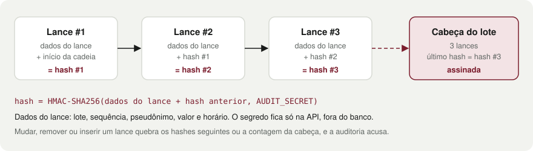

# Auditoria e privacidade

<details>
  <summary>Sumário</summary>

1. [Cadeia de hashes com HMAC](#cadeia-de-hashes-com-hmac)
2. [O que a auditoria detecta](#o-que-a-auditoria-detecta)
3. [Ver funcionando](#ver-funcionando)
4. [Limites conhecidos](#limites-conhecidos)
5. [Privacidade](#privacidade)

</details>

Como o histórico de lances fica à prova de adulteração e como as telas públicas evitam expor quem deu cada lance. [Voltar ao README](../README.md)

## Cadeia de hashes com HMAC

Cada lance guarda um `hash` e o `prevHash` do anterior, formando uma cadeia. O hash é um **HMAC-SHA256** com o segredo `AUDIT_SECRET`, que só a API conhece. Ele cobre o lote, a sequência, o pseudônimo, o valor, o horário e o hash anterior.

O lote guarda a **cabeça** da cadeia (quantidade de lances e último hash), também assinada e gravada na mesma transação do lance.



**Por que HMAC e não SHA-256 puro:** com SHA-256, quem tem acesso ao banco recalcula a cadeia inteira depois de adulterar, e tudo volta a parecer válido. Com HMAC, refazer a cadeia exige o segredo, que não está no banco.

## O que a auditoria detecta

A auditoria pública (`GET /api/audit/lots/:id`, tela `/auditoria/:id`) recalcula tudo a cada consulta e aponta o primeiro lance com problema:

| Adulteração direto no banco | Como é detectada | Código |
|---|---|---|
| Alterar valor, horário ou licitante de um lance | o hash recalculado não confere | `altered` |
| Remover um lance do meio | a sequência e o `prevHash` do próximo quebram | `missing` |
| Remover o último lance | a contagem e o último hash divergem da cabeça assinada | `head_mismatch` |
| Inserir um lance (no fim ou duplicando um `seq`) | não bate com a contagem assinada | `inserted` |
| Trocar líder, lance atual ou vencedor do lote | diverge do último lance da cadeia | `head_mismatch` |

## Ver funcionando

O seed só cria lotes com histórico íntegro. Para ver a detecção, o script `demo:tamper` adultera um lote direto no Mongo (sem passar pela API) e mostra o veredito antes e depois.

1. Escolha um lote com lances (os lotes ao vivo e encerrados do seed têm) e copie o id da URL `/auditoria/<lotId>`. Confirme que o selo está como íntegro.
2. Rode o script, trocando `<lotId>` pelo id copiado:

   ```bash
   docker compose exec api npm run demo:tamper -- <lotId> alter
   ```

   A demonstração foi testada apenas com Docker Compose.
3. O terminal imprime o veredito `Antes` (íntegro), a adulteração aplicada e o veredito `Depois` (com o código do problema).
4. Recarregue `/auditoria/<lotId>` no front: o selo muda para "Histórico adulterado" e os lances com problema ficam marcados.

Modos de adulteração (segundo argumento):

| Modo | O que faz | Código esperado |
|---|---|---|
| `alter` | soma R$ 10,00 ao valor de um lance do meio | `altered` |
| `remove` | apaga um lance do meio | `missing` |
| `remove --last` | apaga o último lance | `head_mismatch` |
| `insert` | insere um lance falso no fim, com hash inventado | `inserted` |

A adulteração fica gravada no banco e não há comando para desfazê-la. Para voltar ao estado íntegro, resete o banco (`docker compose down -v`) ou use outro lote.

## Limites conhecidos

- Quem tem o banco **e** o `AUDIT_SECRET` consegue forjar uma cadeia válida.
- **Volta a um estado antigo.** Uma cabeça assinada antiga continua válida. Quem tem acesso ao banco pode achá-la no oplog ou num backup, apagar os últimos lances e regravar essa cabeça. A auditoria vê uma cadeia mais curta, mas íntegra. Num lote liquidado, o comprovante do vencedor guarda o hash final (`chainHash`) e serve de âncora: se esse hash não aparece mais na cadeia, houve adulteração. Impedir isso por completo exigiria ancoragem externa (carimbo de tempo, blockchain), desproporcional para o projeto.
- Apagar o lote inteiro, com os lances, não deixa nada para auditar, e o comprovante deixa de abrir.
- Trocar o `AUDIT_SECRET` depois que houver lances faz a auditoria acusar adulteração em tudo. O segredo é fixo por ambiente.

Mais detalhes e alternativas descartadas no [ADR 0008](adr/0008-cadeia-de-hashes-hmac.md).

## Privacidade

- Sala, auditoria e comprovante mostram só um **pseudônimo por lote** (`Licitante #A1B2C3`), derivado por HMAC do usuário e do lote. A mesma pessoa tem códigos diferentes em cada lote, então não dá para segui-la entre leilões ([ADR 0009](adr/0009-pseudonimo-por-lote.md)).
- Rotas públicas nunca devolvem id, nome ou e-mail. O próprio usuário vê "Você" no lugar do pseudônimo.
- O pseudônimo tem 6 caracteres hexadecimais. Uma colisão entre dois licitantes do mesmo lote é possível, mas muito improvável (1 em ~16 milhões por par).
